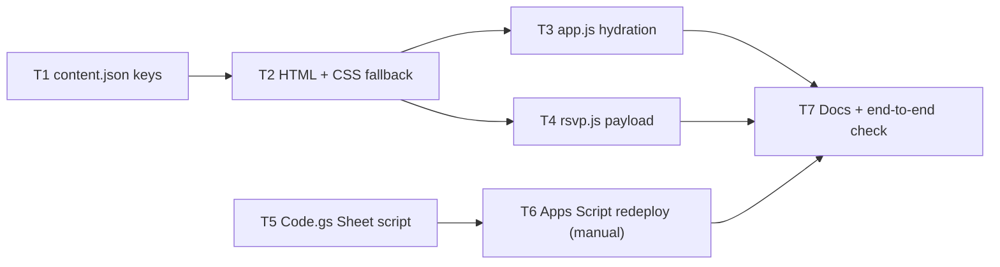

# Technical Implementation Plan: Centralized Content Hydration & Schema Alignment

## Overview
This plan establishes end-to-end dynamic hydration between `content.json` and `index.html` via `app.js` and `rsvp.js`. It addresses verified gaps where fields in `content.json` do not reflect in the DOM, fixes the SVG icon overwrite defect, adds missing semantic DOM bindings, and updates the project documentation to match the real architecture.

---

## 1. Verified Schema Audit & Hydration Mapping

| Section | `content.json` Property | Target DOM Selector / Action | Current Status | Remediation Required |
| :--- | :--- | :--- | :--- | :--- |
| **Meta** | `meta.title` | `document.title` | Hydrated | None |
| **Meta** | `meta.description` | `meta[name="description"]` | Not hydrated | Bind via `setMeta()` |
| **Meta** | `meta.ogTitle` | `meta[property="og:title"]` | Not hydrated | Bind via `setMeta()` |
| **Meta** | `meta.ogDescription` | `meta[property="og:description"]` | Not hydrated | Bind via `setMeta()` |
| **Meta** | `meta.themeColor` | `meta[name="theme-color"]` | Not hydrated | Bind via `setMeta()` |
| **Couple** | `couple.dateDisplay` | `#countdown-date-display` | Hydrated | None |
| **Couple** | `couple.targetDateIso` | Passed to `initCountdown()` | Hydrated | None |
| **Couple** | `couple.locationCity` | Appended to time and footer | Hydrated | None |
| **Couple** | `couple.monogram` | `#hero-monogram` (or eyebrow) | Not in DOM | Add DOM hook & bind |
| **Hero** | `hero.tagline` | `#hero-tagline` | Hydrated | None |
| **Hero** | `hero.heading` | `#hero-names` | Hydrated | None |
| **Hero** | `hero.subheading` | `#hero-subheading` | Hydrated | None |
| **Hero** | `hero.welcomeMessage` | `#hero-message` | Hydrated | None |
| **Hero** | `hero.rsvpButtonText` | `#hero-rsvp-btn` | Hydrated | None |
| **Hero** | `hero.detailsButtonText` | `#hero-details-btn` | Hydrated | None |
| **Countdown** | `countdown.title` | `#countdown-title` | Hydrated | None |
| **Countdown** | `countdown.timeText` | `#countdown-time-display` | Hydrated | None |
| **Countdown** | `countdown.daysLabel` | `#countdown-label-days` | Not in DOM / Not hydrated | Add ID hook to `` & bind |
| **Countdown** | `countdown.hoursLabel` | `#countdown-label-hours` | Not in DOM / Not hydrated | Add ID hook to `` & bind |
| **Countdown** | `countdown.minutesLabel` | `#countdown-label-minutes` | Not in DOM / Not hydrated | Add ID hook to `` & bind |
| **Countdown** | `countdown.secondsLabel` | `#countdown-label-seconds` | Not in DOM / Not hydrated | Add ID hook to `` & bind |
| **Countdown** | `countdown.calendarEvent.*` | Passed to `initCalendar()` | Hydrated | None |
| **Locations** | `locations.title` | `#locations-title` | No ID in HTML / Not hydrated | Add ID to `<h2>` & bind |
| **Locations** | `locations.subtitle` | `#locations-subtitle` | No ID in HTML / Not hydrated | Add ID to `
` & bind |
| **Locations** | `locations.church.badge` | `#church-badge` | No ID in HTML / Not hydrated | Add ID to `` & bind |
| **Locations** | `locations.church.time` | `#church-time` | No ID in HTML / Not hydrated | Add ID to `` & bind |
| **Locations** | `locations.church.name` | `#church-name` | Hydrated | None |
| **Locations** | `locations.church.address` | `#church-address-text` | **Defect** (Wipes SVG icon) | Change target to inner `` |
| **Locations** | `locations.church.description` | `#church-desc` | Hydrated | None |
| **Locations** | `locations.church.mapsUrl` | `#church-maps-link` (href) | Hydrated | None |
| **Locations** | `locations.venue.badge` | `#venue-badge` | No ID in HTML / Not hydrated | Add ID to `` & bind |
| **Locations** | `locations.venue.time` | `#venue-time` | No ID in HTML / Not hydrated | Add ID to `` & bind |
| **Locations** | `locations.venue.name` | `#venue-name` | Hydrated | None |
| **Locations** | `locations.venue.address` | `#venue-address-text` | **Defect** (Wipes SVG icon) | Change target to inner `` |
| **Locations** | `locations.venue.description` | `#venue-desc` | Hydrated | None |
| **Locations** | `locations.venue.mapsUrl` | `#venue-maps-link` (href) | Hydrated | None |
| **Transport** | `transportation.title` | `#transport-title` | Hydrated | None |
| **Transport** | `transportation.subtitle` | `#transport-subtitle` | Hydrated | None |
| **Transport** | `transportation.note` | `#transport-note` | Missing in DOM / Ignored | Add `
` & bind |
| **Transport** | `transportation.routes` | `#transport-container` | Hydrated dynamically | Make timetable headers configurable |
| **RSVP** | `rsvp.title` | `#rsvp-title` | No ID in HTML / Not hydrated | Add ID to `<h2>` & bind |
| **RSVP** | `rsvp.subtitle` | `#rsvp-subtitle` | No ID in HTML / Not hydrated | Add ID to `
` & bind |
| **RSVP** | `rsvp.description` | `#rsvp-desc` | Not hydrated | Bind or append to subtitle |
| **RSVP** | `rsvp.labels.firstName` | `#label-first-name` | No ID / Not hydrated | Add ID to `<label>` & bind |
| **RSVP** | `rsvp.labels.firstNamePlaceholder` | `#first_name` (placeholder) | Not hydrated | Bind placeholder attribute |
| **RSVP** | `rsvp.labels.lastName` | `#label-last-name` | No ID / Not hydrated | Add ID to `<label>` & bind |
| **RSVP** | `rsvp.labels.lastNamePlaceholder` | `#last_name` (placeholder) | Not hydrated | Bind placeholder attribute |
| **RSVP** | `rsvp.labels.email` | `#label-email` | No ID / Not hydrated | Add ID to `<label>` & bind |
| **RSVP** | `rsvp.labels.emailPlaceholder` | `#email` (placeholder) | Not hydrated | Bind placeholder attribute |
| **RSVP** | `rsvp.labels.attendingQuestion` | `#label-attending-question` | No ID / Not hydrated | Add ID to `` & bind |
| **RSVP** | `rsvp.labels.attendingYes` | `#label-attending-yes` | No ID / Not hydrated | Add ID to radio span & bind |
| **RSVP** | `rsvp.labels.attendingNo` | `#label-attending-no` | No ID / Not hydrated | Add ID to radio span & bind |
| **RSVP** | `rsvp.labels.hasPlusOneQuestion` | `#label-has-plus-one` | No ID / Not hydrated | Add ID to toggle title & bind |
| **RSVP** | `rsvp.labels.plusOneFirstName` | `#label-plus-one-first-name` | No ID / Not hydrated | Add ID to `<label>` & bind |
| **RSVP** | `rsvp.labels.plusOneFirstNamePlaceholder` | `#plus_one_first_name` (placeholder) | Not hydrated | Bind placeholder attribute |
| **RSVP** | `rsvp.labels.plusOneLastName` | `#label-plus-one-last-name` | No ID / Not hydrated | Add ID to `<label>` & bind |
| **RSVP** | `rsvp.labels.plusOneLastNamePlaceholder` | `#plus_one_last_name` (placeholder) | Not hydrated | Bind placeholder attribute |
| **RSVP** | `rsvp.labels.dietaryPreference` | `#label-dietary-preference` | No ID / Not hydrated | Add ID to `<label>` & bind |
| **RSVP** | `rsvp.labels.dietaryOptions` | `#dietary_preference` (options) | Hardcoded in HTML | Hydrate dynamically from JSON |
| **RSVP** | `rsvp.labels.allergies` | `#label-allergies` | No ID / Not hydrated | Add ID to `<label>` & bind |
| **RSVP** | `rsvp.labels.allergiesPlaceholder` | `#allergies` (placeholder) | Not hydrated | Bind placeholder attribute |
| **RSVP** | `rsvp.labels.needsBusQuestion` | `#label-needs-bus` | No ID / Not hydrated | Add ID to toggle title & bind |
| **RSVP** | `rsvp.labels.busStopLabel` | `#label-bus-stop` | No ID / Not hydrated | Add ID to `<label>` & bind |
| **RSVP** | `rsvp.labels.busStopOptions` | `#bus_stop` (options) | Hydrated dynamically | None |
| **RSVP** | `rsvp.labels.busNotes` | `#label-bus-notes` | No ID / Not hydrated | Add ID to `<label>` & bind |
| **RSVP** | `rsvp.labels.busNotesPlaceholder` | `#bus_notes` (placeholder) | Not hydrated | Bind placeholder attribute |
| **RSVP** | `rsvp.labels.submitButton` | `#submit-text` | Only hydrated on reset | Hydrate on initial page load |
| **RSVP** | `rsvp.labels.submittingButton` | `#submit-text` (loading state) | Hydrated | None |
| **RSVP** | `rsvp.labels.submitAnotherButton` | `#submit-another-btn` | Not hydrated | Bind button text |
| **Gifts** | `gifts.title` | `#gifts-title` | Hydrated | None |
| **Gifts** | `gifts.subtitle` | `#gifts-subtitle` | Hydrated | None |
| **Gifts** | `gifts.message` | `#gifts-message` | Hydrated | None |
| **Gifts** | `gifts.bankDetails.concept` | `#bank-concept` | Missing from DOM | Add Concept row to HTML & bind |
| **Gifts** | `gifts.copyIbanButtonText` | `#copy-iban-text` | Only hydrated on reset | Hydrate on initial page load |
| **Footer** | `footer.signature` | `#footer-names` | Hydrated | None |
| **Footer** | `footer.date` | `#footer-date` | Hydrated | None |
| **Footer** | `footer.tagline` | `#footer-tagline` | Hydrated | None |

---

## 2. Implementation Phases

### Phase 1: DOM Hook Preparation (`index.html`)
- Assign unique, semantic IDs to previously unhooked text nodes, labels, placeholders, and badges.
- Isolate text spans inside `#church-address` and `#venue-address` (`#church-address-text` and `#venue-address-text`) to preserve the `<svg>` location pin icon.
- Add the missing Bank Transfer Concept row in the `#gifts` section.
- Add the missing Transportation note element (`#transport-note`).
- Add IDs for the countdown ticker unit labels (`#countdown-label-days`, etc.).

### Phase 2: Core Hydration Engine Enhancement (`js/app.js` & `js/rsvp.js`)
- Implement `setMeta()`, `setAttr()`, `setLabelWithReq()`, and `hydrateSelectOptions()`.
- Expand `hydrateContent()` in `app.js` to cover 100% of keys in `content.json`.
- Dynamically render `#dietary_preference` select options using `content.rsvp.labels.dietaryOptions`.
- Hydrate all RSVP field labels, placeholders, toggle labels, and initial button text.
- Hydrate metadata (`<meta name="description">`, OpenGraph tags, theme-color).

### Phase 3: Comprehensive Verification & Stress Testing
- Create a test verification script or automated check confirming that changing any property in `content.json` alters the rendered DOM.
- Verify that icons, accessibility attributes, Honeypot spam defense, and form submissions remain 100% operational.

### Phase 4: Documentation Synchronization
- Update `README.md` to document the exact, complete `content.json` structure (removing non-existent references like `schedule.events` and `infoPlaceholder`).
- Update `docs/intent/wedding_page.md` and `docs/decisions/ADR-003-content-json-decoupling.md` to reflect full hydration of badges, times, notes, concept, and form labels.

---
---

# Technical Implementation Plan: RSVP Comfortable Shoe Size (`rsvp-shoe-size`)

> Spec: [SPEC-rsvp-shoe-size.md](../SPEC-rsvp-shoe-size.md) (approved 2026-10-05)

## Overview
Add one optional `shoe_size` dropdown as the last RSVP field. The size list (35–43) lives in one editable array in `content.json`. `Code.gs` keeps its own copy, checks submitted values against it, and writes them to a new last Sheet column (N, `Shoe Size`).

## Components & Dependencies

## Implementation Order
1. **T1: Content keys.** Data first, so every later step reads the real values.
2. **T2: Markup + `.form-hint`.** The static fallback works on its own, even if `content.json` fails to load.
3. **T3: Fill in the dropdown and copy from `content.json`** and **T4: Payload.** Independent of each other, so they can be done in either order.
4. **T5: `Code.gs`.** Independent of the frontend and can be done in parallel with T1–T4.
5. **T6: Redeploy the Apps Script.** Manual, done by the couple in Google. Must happen before the live check.
6. **T7: Docs + end-to-end check.** ADR-002, Apps Script README, live submission → Sheet.

## Risks & Mitigations
| Risk | Impact | Mitigation |
|---|---|---|
| Apps Script not redeployed | Size never saved, with no error shown | T6 is its own step; T7 checks column N with a live row |
| `SHOE_SIZES` ≠ `shoeSizeOptions` | Valid choices stored as empty | Sync comment in both places; README rule; criterion 7 tests adding "44" |
| Column added in the middle | Every column after it would be misaligned | Spec boundary: add the column **last**; T5 checks the header count |
| Sheet already has rows | Header not written automatically | Check before T6; add the N1 header by hand if needed |
| `googleAppsScriptUrl` cleared for testing gets committed | Live RSVPs lost | Clear it locally only; check `git diff content.json` before committing |
| Formula injection through the size | Sheet compromised | Whitelist check before `sanitizeCell` |

## Verification Checkpoints
- **After T2:** page loads, field is last, fallback options 35–43 are shown.
- **After T4:** simulated submission payload shows correct `shoe_size` for blank / 38 / 38 + decline.
- **After T5:** a mock `doPost` in the Apps Script editor writes column N correctly and rejects forged values.
- **After T7:** a live row in the Sheet and all 14 spec success criteria pass.

---
---

# Technical Implementation Plan: RSVP Shuttle Bus Legs, General Comments & Couple Contact (`SPEC-rsvp-buses-and-contacts`)

> Spec: [SPEC-rsvp-buses-and-contacts.md](../docs/specs/SPEC-rsvp-buses-and-contacts.md) (approved 2026-10-20)

## Overview
Upgrade the RSVP form and contact layout to provide a mobile-first, accessible, and frictionless experience:
1. Replace the single bus stop dropdown and bus notes textarea with 3 independent shuttle bus leg radio-pill groups (`bus_to_church`, `bus_church_to_venue`, `bus_return`) and a dynamic `aria-live="polite"` seat count notice (1 vs. 2 seats when companion is toggled).
2. Add a general `comments` textarea (max 500 chars) at the end of the form before the submit button.
3. Add a borderless, pure-typography Couple Contact section (`#contact`) after `#gifts` and before `<footer>` with Lourdes on the left and Carlos on the right.
4. Update `google-apps-script/Code.gs` and documentation for the 16-column Google Sheet schema with whitelist and anti-formula sanitization.

## Architecture Decisions
- **Vertical Feature Slicing:** After defining the data contract in `content.json` (Task 1), each user-facing capability—Shuttle Bus Legs + Dynamic Seat Notice (Task 2), General Comments (Task 3), and Couple Contact Section (Task 4)—is delivered as an end-to-end vertical slice.
- **Progressive Enhancement Fallbacks:** `index.html` pre-renders default Spanish copy and default radio selections (`none` for Leg 1 & Leg 3, `yes` for Leg 2) so the form and contact links work even if `content.json` fails to fetch.
- **Hardened Sheet Sync:** `Code.gs` validates bus legs against option whitelists (`BUS_LEG_1_3_OPTIONS`, `BUS_LEG_2_OPTIONS`) and sanitizes `comments` via `sanitizeCell(data.comments, 500)`.

## Risks and Mitigations
| Risk | Impact | Mitigation |
|---|---|---|
| Radio pill labels overflow on 320px screens | Med | Use `flex: 1 1 0; min-width: 0; font-size: 0.8125rem; line-height: 1.2;` on `.bus-leg-group .radio-pill-label`. |
| Hydration overwrites `<svg>` icons inside `#contact-phone-*` / `#contact-email-*` | High | Target inner `` for text and `setAttr('contact-phone-1', 'href', ...)` for link URLs. |
| Existing Google Sheet already has 14-column header row | Med | Document exact Columns L–P header update instructions in `google-apps-script/README.md`. |
| Formula injection via `comments` textarea | High | Enforce `sanitizeCell(data.comments, 500)` in `Code.gs` and whitelist check on bus leg values. |

